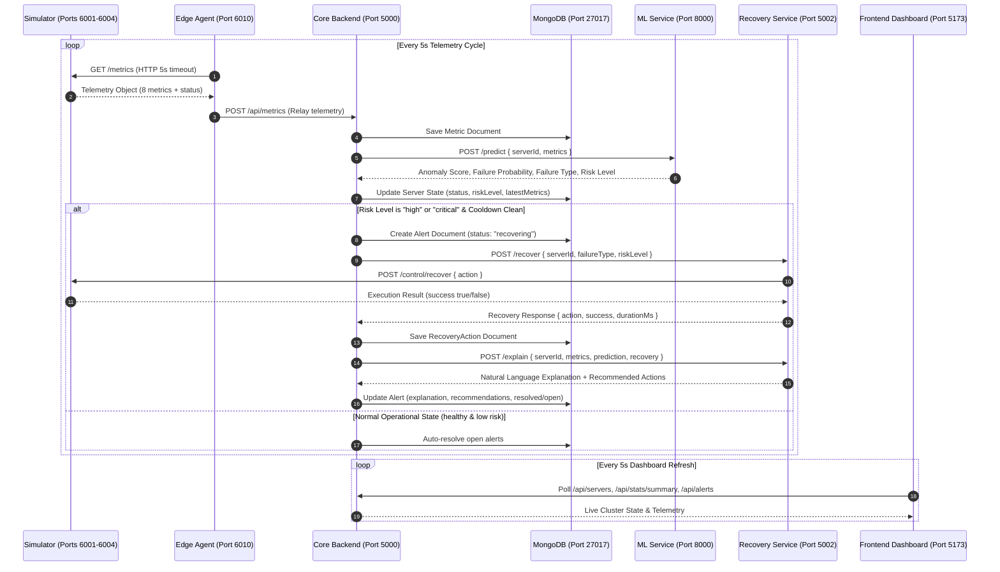

# CloudGuardian AI

> **An AI-Based Self-Healing Cloud Infrastructure for Predictive Failure Detection and Automated Service Recovery**  
> *Innovation Design Project • Vellore Institute of Technology*

---

## 🏛️ Academic & Project Attribution

- **Institution**: Vellore Institute of Technology
- **Department**: Department of Information Technology
- **Faculty Guide**: Dr. LAWANYA SHRI M
- **Project Title**: CloudGuardian AI: An AI-Based Self-Healing Cloud Infrastructure for Predictive Failure Detection and Automated Service Recovery

### 👥 Team Members & Designated Module Owners

| Member | Student ID | Designated Modules / Folders | Key Responsibilities |
| :--- | :--- | :--- | :--- |
| **Rishi Rennish** | 25BIT0182 | `simulator/`, `agent/`, `infra/`, `shared/` | System architecture, cloud server simulator, edge metrics agent, Docker Compose, Kubernetes manifests |
| **Sohani Mohapatra** | 25BIT0194 | `ml-service/` | Machine learning models, Isolation Forest anomaly scoring, Random Forest multi-class failure classification |
| **Vedansh Mahto** | 25BIT0190 | `backend/` | Central Express/MongoDB backend, telemetry ingestion pipeline, alert lifecycle state machine |
| **Krishna Shroff** | 25BIT0239 | `frontend/` | React 18, Vite & Tailwind CSS operations dashboard, live topology maps, dynamic metrics charts |
| **Rishav Raj** | 25BIT0061 | `recovery-service/`, `tests/`, `docs/` | Autonomic recovery engine, safety invariants, GenAI explainability engine, test suites & documentation |

---

## 📖 Overview

Modern cloud architectures face catastrophic downtime caused by silent, gradual failure modes (memory leaks, CPU saturation, disk space starvation, and network congestion). Traditional APM solutions rely on static metric thresholds that either trigger alert storms or fire too late.

**CloudGuardian AI** implements a closed-loop autonomic feedback loop:
1. **Continuous Telemetry**: Gathers 8-dimensional operational telemetry every 5 seconds across cloud servers.
2. **Proactive AI Forecasting**: Evaluates telemetry using a dual-stage ML engine (Isolation Forest anomaly scoring + Random Forest failure classification) to detect anomalies 15–30 seconds before system outage.
3. **Autonomous Self-Healing**: Automatically triggers targeted remediation actions (`restart_service`, `scale_up`, `cleanup_disk`, `throttle_traffic`, `failover`) guarded by strict safety invariants (60s cooldowns, rate limits).
4. **Transparent Explainability**: Synthesizes plain-English diagnostic explanations and human follow-up recommendations to ensure zero-black-box operations.

---

## 🏗️ Architecture & Data Flow

The autonomic control loop strictly complies with `shared/CONTRACT.md`:



---

## 🔌 Network Ports & Services Table

| Service | Container Name | Local Host Port | Container Internal Port | Protocol / Path | Description |
|---|---|---|---|---|---|
| **Frontend** | `cloudguardian-frontend` | `5173` | `80` | HTTP / Nginx | Operations dashboard & simulation UI |
| **Backend** | `cloudguardian-backend` | `5000` | `5000` | HTTP / Express | Central API & orchestration engine |
| **Recovery Service** | `cloudguardian-recovery-service` | `5002` | `5002` | HTTP / Express | Policy recovery & explainability service |
| **ML Service** | `cloudguardian-ml-service` | `8000` | `8000` | HTTP / FastAPI | Anomaly scoring & failure classification |
| **Web Server 01** | `cloudguardian-simulator` | `6001` | `6001` | HTTP / Express | Simulated Web Node (`srv-web-01`) |
| **API Server 01** | `cloudguardian-simulator` | `6002` | `6002` | HTTP / Express | Simulated API Node (`srv-api-01`) |
| **Database Server 01** | `cloudguardian-simulator` | `6003` | `6003` | HTTP / Express | Simulated DB Node (`srv-db-01`) |
| **Cache Server 01** | `cloudguardian-simulator` | `6004` | `6004` | HTTP / Express | Simulated Cache Node (`srv-cache-01`) |
| **Edge Agent** | `cloudguardian-agent` | `6010` | `6010` | HTTP / Node.js | Edge metrics collector & health check |
| **MongoDB** | `cloudguardian-mongo` | `27017` | `27017` | TCP / Mongo Wire | Metric storage & alert persistence |

---

## 🚀 One-Command Launch (Docker Compose)

To start the entire CloudGuardian AI platform with a single command:

```bash
docker compose -f infra/docker-compose.yml up --build
```

To run in the background (detached mode):
```bash
docker compose -f infra/docker-compose.yml up -d --build
```

To stop all services and tear down containers and volumes:
```bash
docker compose -f infra/docker-compose.yml down -v
```

---

## 🧪 Verification & Test Suite

### 1. Contract Test Suite
Validates health, schemas, and enum conformance across all services:
```bash
cd tests
npm install
node contract.test.js
```

### 2. End-to-End Fault Remediation Benchmark
Runs automated fault injections on `srv-web-01` across all 5 fault types, measuring detection latency, recovery latency, and server health:
```bash
cd tests
node e2e.js
```

---

## 🎬 2-Minute Live Demo Walkthrough

1. **Baseline View (0:00 - 0:25)**: Open `http://localhost:5173`. Confirm all four servers display green (`healthy`) with low risk scores and zero open alerts.
2. **Inject Fault (0:25 - 0:50)**: In the Simulation panel, click **Inject Memory Leak** on `srv-web-01` (or execute `curl.exe -X POST http://localhost:5000/api/simulate/fault -H "Content-Type: application/json" -d "{\"serverId\":\"srv-web-01\",\"faultType\":\"memory_leak\"}"`).
3. **Predictive Detection (0:50 - 1:20)**: Observe memory climb towards 97%. At ~37s, the ML model detects the anomaly, raises risk to `critical`, and automatically initiates remediation.
4. **Autonomous Self-Healing (1:20 - 1:45)**: The Recovery Engine accepts action `restart_service`. In 5 seconds, memory resets to healthy baseline (41%), and the alert status updates to `resolved`.
5. **AI Explainability (1:45 - 2:00)**: Click the resolved alert to review the natural-language diagnostic explanation and human follow-up recommendations.

---

## 🛠️ Troubleshooting Guide

### 1. Docker Daemon / Docker Desktop Not Running
- **Symptom**: `docker : The term 'docker' is not recognized` or `Cannot connect to the Docker daemon`.
- **Solution**: Ensure Docker Desktop is installed and running with WSL 2 backend enabled. If running without Docker, start services individually using their local run commands documented in each module README.

### 2. Port Already in Use (EADDRINUSE)
- **Symptom**: `Error: listen EADDRINUSE: address already in use :::5000` (or ports 5002, 6001–6004, 8000, 27017).
- **Solution**: Identify the process occupying the port and terminate it:
  ```powershell
  # Windows PowerShell:
  Get-NetTCPConnection -LocalPort 5000 | ForEach-Object { Stop-Process -Id $_.OwningProcess -Force }
  ```

### 3. MongoDB Not Healthy
- **Symptom**: Backend logs: `Fatal: Failed to connect to MongoDB at mongodb://mongo:27017/cloudguardian`.
- **Solution**:
  - Verify container status: `docker compose -f infra/docker-compose.yml ps mongo`.
  - Check health test: `docker compose -f infra/docker-compose.yml logs mongo`.
  - Recreate database volume: `docker compose -f infra/docker-compose.yml down -v && docker compose -f infra/docker-compose.yml up -d mongo`.

---

## 📂 Repository Structure Reference

```
cloudguardian-ai/
├── shared/             # SHARED CONTRACT (never rename anything) & servers.json
├── simulator/          # Virtual cloud servers with dynamic telemetry & fault injection
├── agent/              # Edge metrics collection agent
├── backend/            # Express orchestrator & MongoDB persistence
├── ml-service/         # Isolation Forest & Random Forest predictive ML service
├── recovery-service/   # Remediation engine, safety cooldowns & explainability
├── frontend/           # React 18, Vite & Tailwind CSS dashboard
├── infra/              # Docker Compose, Kubernetes manifests, AWS deployment notes
├── tests/              # Contract verification and E2E benchmarking suites
└── docs/               # System architecture, project report, patent notes & demo script
```
