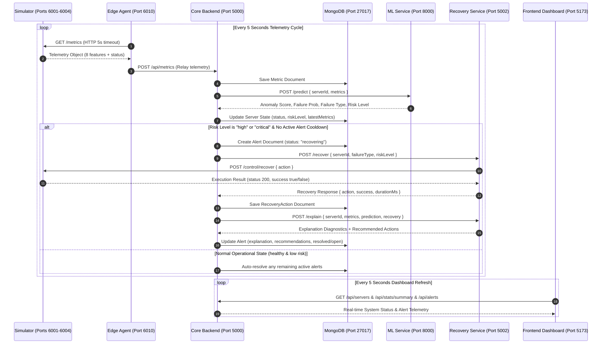
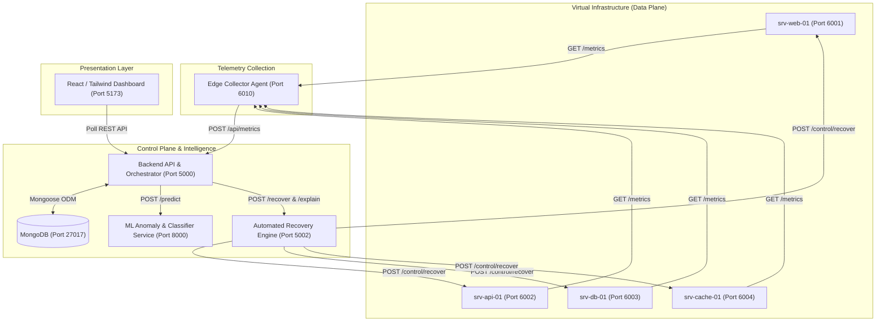

# CloudGuardian AI - System Architecture

CloudGuardian AI is an autonomous, AI-driven cloud reliability and self-healing infrastructure. The system executes a closed-loop autonomic feedback loop: collecting real-time telemetry, detecting multi-variate operational anomalies using machine learning, executing automated self-healing remediation, and generating transparent natural language explanations.

---

## 1. Architectural Flow Diagram

The end-to-end data and control flow strictly implements the autonomic control loop defined in `shared/CONTRACT.md`:

---

## 2. High-Level Component Topology

---

## 3. Technology Stack Reference

| Service / Layer | Container Name | Runtime & Framework | Host Port | Internal Port | Key Responsibilities |
|---|---|---|---|---|---|
| **Simulator** | `cloudguardian-simulator` | Node.js 20 LTS, Express, CommonJS | 6001–6004 | 6001–6004 | Simulates 4 virtual cloud servers with realistic drift, fault injection (`/control/fault`), dynamic recovery, and reset. |
| **Agent** | `cloudguardian-agent` | Node.js 20 LTS, Axios, CommonJS | 6010 | 6010 | Autonomous metric collector polling simulator instances every 5s and relaying to backend. |
| **Backend** | `cloudguardian-backend` | Node.js 20 LTS, Express, Mongoose | 5000 | 5000 | Central orchestrator, REST API, MongoDB persistence, alert lifecycle management, recovery coordination. |
| **Database** | `cloudguardian-mongo` | MongoDB 7.0 | 27017 | 27017 | Persistence for servers, historical metrics (TTL 24h), alerts, and recovery action logs. |
| **ML Service** | `cloudguardian-ml-service` | Python 3.11/3.13, FastAPI, Uvicorn | 8000 | 8000 | IsolationForest unsupervised anomaly scoring and RandomForestClassifier multi-class failure prediction. |
| **Recovery Service** | `cloudguardian-recovery-service` | Node.js 20 LTS, Express, Axios | 5002 | 5002 | Policy-based recovery engine enforcing cooldowns, rate limits, fault-to-action routing, and explanation synthesis. |
| **Frontend** | `cloudguardian-frontend` | React 18, Vite, Tailwind CSS 3.4 | 5173 | 80 (nginx) | Real-time operations dashboard, topology views, historical charts (Recharts), and simulation controls. |

---

## 4. Contract Enums & Mappings

### Failure Modes & Remediation Matrix

| Failure Type | Target Action | Fallback Strategy | Primary Symptoms |
|---|---|---|---|
| `cpu_overload` | `scale_up` | Alert human operator | CPU > 85%, responseTimeMs > 1000ms |
| `memory_leak` | `restart_service` | `failover` | Memory > 85%, gradual latency increase |
| `disk_full` | `cleanup_disk` | Storage expansion request | Disk > 90%, errorRate > 5% |
| `network_congestion` | `throttle_traffic` | Rate limit ingress | NetworkIn/Out > 800 Mbps, latency spike |
| `service_crash` | `restart_service` | `failover` (automatic retry) | Server status `down`, CPU = 0, errorRate = 100% |
| `none` | `none` | N/A | Baseline healthy state |

### Autonomic Risk Level Thresholds
- **Low Risk (`< 0.30`)**: Normal operation; alerts auto-resolved.
- **Medium Risk (`0.30 – 0.59`)**: Warning stage; no intrusive automated actions taken (safety policy).
- **High Risk (`0.60 – 0.84`)**: Critical degradation imminent; automated remediation triggered.
- **Critical Risk (`>= 0.85`)**: Severe failure imminent or active; immediate automated remediation executed.

